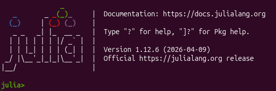
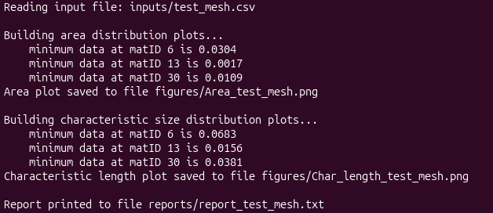

# Julia_tools_for_pre_post_BASEMENT_simulation_analisys

This tool was developed by Amedeo Repele. For any bugs in the code or requests for information, please send a message to _amedeo.repele@unitn.it_. It is assumed here the functionalities and the functioning of BASEMENT [(website)](https://basement.ethz.ch/) are known. The tools reported here are meant to provide additional (useful) tools to the BASEMENT users, partially including some python script developed by ETH [BASEtools](https://basement.ethz.ch/download/tools/python-scripts.html).

List of requirements and performance/utilization tips [here](docs/requirements_tips.md). Please read it first: in particular, the README assumes the **Optional** part (the ``JULIA_PROJECT`` environment variable) has been set up.

The repository contains the julia (and python) scripts for doing the following:  

1. PRE: Computing statistical quantities for BASEMENT mesh, in order to help analyzing the mesh prior to setting up any simulation (``mesh_stats.jl``);
2. POST: Extracting the discharge, the water surface elevation (WSE) or all the available data time series for any nodestring defined within the mesh and the model.json file, and plotting discharge, WSE or both (``BMv4x*.py``, ``plot_all.jl``, ``custom_plot.jl``);
3. POST: Finding which cell is determining the time step size of the simulation, for a single frame (output time) of the results (``find_dt.jl``).

Quick overview of the scripts:

| Script | Language | What it does | Reads | Writes |
|---|---|---|---|---|
| ``py_src/Julia_tools_initializer.py`` | Python | Creates the working folder structure and copies the scripts | — | folders, scripts, ``Project.toml`` |
| ``src/mesh_stats.jl`` | Julia | Mesh statistics (area and CFL length) | ``inputs/<mesh>.csv``, ``inputs/<regions>.txt`` | ``outputs/figures/``, ``outputs/reports/`` |
| ``py_src/BMv41discharge.py`` / ``BMv42discharge.py`` | Python | Discharge of every nodestring | ``inputs/*results.h5`` | ``outputs/*discharge.csv`` |
| ``py_src/BMv41wse.py`` / ``BMv42wse.py`` | Python | Mean WSE of every nodestring | ``inputs/*results.h5`` | ``outputs/*wse.csv`` |
| ``py_src/BMv41nsalldata.py`` / ``BMv42nsalldata.py`` | Python | All the nodestring data, for selected nodestrings | ``inputs/*results.h5`` | ``outputs/<file>_<nodestring>.csv`` |
| ``src/plot_all.jl`` | Julia | Plots all the nodestrings (discharge / WSE / both) | ``outputs/*discharge.csv``, ``outputs/*wse.csv`` | ``outputs/figures/`` |
| ``src/custom_plot.jl`` | Julia | Plots selected nodestrings (discharge / WSE / both) | ``outputs/*discharge.csv``, ``outputs/*wse.csv`` | ``outputs/figures/`` |
| ``src/find_dt.jl`` | Julia | Cell limiting the time step | ``inputs/<cells>.csv`` | ``outputs/reports/`` |

**Important:** all the scripts use paths relative to the folder from which they are launched (``inputs/``, ``outputs/``, ...). Always run them from the working folder (the one prepared with ``Julia_tools_initializer.py``, see below, or the repository folder itself), typing for example ``python py_src/BMv41wse.py`` or ``julia src/plot_all.jl``.

## Folder structure initialization
One of the python script (``Julia_tools_initializer.py``) is devoted to initialize the working tree as first time. Once you have cloned this repository (or downloaded in any way) then locate to the folder in which you want to analyze the results and run the python script using:
````
cd path/to/results/folder
python path/to/Julia_tools_initializer.py
````

As for example, mine command would be:
````
python ~/Documents/Julia_tools_for_pre_post_BASEMENT_simulation_analisys/py_src/Julia_tools_initializer.py 
````

The script:

1. creates the folders ``inputs/``, ``outputs/``, ``outputs/figures/``, ``outputs/reports/``, ``py_src/`` and ``src/`` in the current folder (existing folders and files inside them are kept);
2. copies all the python scripts (``py_src/*.py``) and julia scripts (``src/*.jl``) from the repository, so they are always upgraded to the version of the repository you have downloaded (existing copies with the same name are overwritten);
3. copies the ``Project.toml`` file and runs ``src/Julia_instantiator.jl``, which creates the ``Manifest.toml`` and installs the Julia packages (this can take a while the first time).

The repository location is found automatically from the position of the script itself, so the script must be run from inside a local copy of the repository (do not move it alone elsewhere). Step 3 requires Julia to be installed and the **Optional** environment variable to be set (see [requirements](docs/requirements_tips.md)).

Then copy your BASEMENT results (``*results.h5``) and/or mesh csv files into ``inputs/``.

# 1. PRE: mesh_stats.jl
## Description
### Arguments

The Julia script requires the following arguments:

1. ``input_file.csv``: this file contains the mesh information and must include the following columns:
	1.	fid: cell id within the mesh
	2.	matid: material id of the cell
	3.	area: area of the cell
	4.	min_len: minimum length of each cell (CFL reference length for BASEMD)
	5.	ins_rad: radius of the inscribed circle for each mesh (CFL reference length for BASEHPC)

    The order of the columns is not important, but the name do! Other additional columns can be present with any name, it will not be a problem. The only restriction is that the five columns above have the correct name.  
	Columns can be obtained using QGIS, for a complete tutorial on how to get them see [Getting_fields_QGIS_tutorial](docs/tutorial_getting_fields.md).

2. ``MatIDfile.txt``: this file contains the list of the material IDs (matIDs) for which the user wants to plot statistics. It also allows the user to specify whether a logarithmic (base 10) scale should be used for the vertical axis of each subplot to improve the visualization of the Area and Characteristic Size distributions, and the name of the region shown in the legend. It is a comma separated file with one header line and one row per matID, for example (``inputs/test_regions.txt``):

    ````
    matID, y_log_scale, name
    6, 0, Material_1
    13, 1, Material_2
    30, 0, Material_3
    ````

    where ``y_log_scale`` is ``1`` (logarithmic scale) or ``0`` (linear scale);

3. ``BASEflow``: this argument specifies which BASEMENT model the user is using. Accepted values are ``BASEMD`` and ``BASEHPC``. If the mesh does not originate from the BASEMENT environment, select the option that matches the CFL condition described in the reference manual of the model of interest, or simply choose the most appropriate one according to the definitions given above.

4.  ``FigureFormat``: this allows the user to specify the format of the output figures. Accepted values are ``png``, ``jpg``, ``pdf``, and ``svg``. Do **not** include the dot. For example, ``pdf`` is correct, while ``.pdf`` is not;

Both files must be placed in the ``inputs/`` folder and must be given **by name only**, without the ``inputs/`` folder (the script adds it automatically).

### Outputs

The tool produces three output files: two graphical outputs and one quantitative report.

1. ``outputs/figures/Area_input_file.FigureFormat``: this plot shows the distribution of cell areas for each material ID selected in ``MatIDfile.txt``. The vertical lines represent the quantile values [0.1%, 1%], which are the default settings. These values can be customized within the script (``quantiles_intervals``).

2. ``outputs/figures/Char_length_input_file.FigureFormat``: this is analogous to the previous plot, but it considers the characteristic length used by the CFL condition. The same quantiles are displayed.

3. ``outputs/reports/Report_input_file.txt``: this report provides, for both datasets and for each material ID, the number of cells below each quantile together with their cell IDs. This allows the user to easily identify the smallest cells and the potential computational bottlenecks.

## Running the tool

Read **Optional** first ([here](docs/requirements_tips.md)).

To run the ``mesh_stats.jl`` script, open a terminal, navigate to the working folder using the ``cd`` command, and then proceed as follows.

#### First run (or whenever Julia indicates it is needed)

If you used ``Julia_tools_initializer.py`` this step has already been done for you, and you can go directly to the next section.

Start a Julia REPL by typing:

````
julia
````

The REPL has the following layout:



Then enter package mode by pressing the ``]`` key and run:
````
instantiate
````

or equivalently:

````
using Pkg
Pkg.instantiate()
````


A ``Manifest.toml`` file should now be created in the project folder. This file is generated from the ``Project.toml`` file, which is already included in the repository.  

In case the command ````instantiate```` is not running, try:

````
update
```` 
or equivalently:

````
using Pkg
Pkg.update()
````

first, and then ````instantiate````.

You can now follow the instructions below.

#### From the second run onward

Run the following command from the terminal:
````
julia src/mesh_stats.jl input_file.csv MatIDfile.txt BASEflow FigureFormat 
````

Remember to replace the arguments with the appropriate values.

***Example***  
This example is already included in the repository (files ``inputs/test_mesh.csv`` and ``inputs/test_regions.txt``).

Run the following command:
````
julia src/mesh_stats.jl test_mesh.csv test_regions.txt BASEHPC png
````

If everything has been set up correctly, the terminal should display the following:



and the files ``outputs/figures/Area_test_mesh.png``, ``outputs/figures/Char_length_test_mesh.png`` and ``outputs/reports/Report_test_mesh.txt`` are created.


# 2. POST: nodestring results (BMv4x*.py, plot_all.jl, custom_plot.jl)

The workflow has two steps: first the nodestring results are extracted from the ``*results.h5`` files to csv files with the python scripts (step A), then the csv files are plotted with the julia scripts (step B).

For every python script there are two versions: ``BMv41*.py`` for BASEMENT version 4.1 and ``BMv42*.py`` for BASEMENT version 4.2. Use just the one matching your BASEMENT version. Also the script for BASEMENT version 4.0 is available online at [BASEtools](https://basement.ethz.ch/download/tools/python-scripts.html), in case you need it, pay attention to the inputs/outputs paths.  
All the python scripts automatically look for every file ending with "results.h5" within the "inputs/" folder and write one output file per results file in the "outputs/" folder. The output name is obtained by removing ``_results.h5`` from the input name (e.g. ``inputs/sim_results.h5`` → ``outputs/sim_discharge.csv``), so name your results files ``<name>_results.h5``. The python scripts require the ``h5py`` and ``numpy`` libraries (``pip install h5py numpy``).

## Step A: extracting the data (python)

**Discharge.**

- ``BMv41discharge.py``: extracts the discharge of every nodestring to csv (BASEMENT version 4.1, second column of ``/RESULTS/NodeStrg/StateVar``);
- ``BMv42discharge.py``: extracts the discharge of every nodestring to csv (BASEMENT version 4.2, second column of ``/RESULTS/NodeStrg/HydState``).

Output: ``outputs/*discharge.csv``. Columns are ``t [s]`` followed by ``Q_<nodestring> [m3/s]`` for every nodestring. Run the file typing:

````
python py_src/BMv41discharge.py
````
````
python py_src/BMv42discharge.py
````

**Water surface elevation (WSE).** The same can be done for the mean water surface elevation of each nodestring:

- ``BMv41wse.py``: extracts the mean WSE of every nodestring to csv (BASEMENT version 4.1, first column of ``/RESULTS/NodeStrg/StateVar``);
- ``BMv42wse.py``: extracts the mean WSE of every nodestring to csv (BASEMENT version 4.2, first column of ``/RESULTS/NodeStrg/HydState``).

Output: ``outputs/*wse.csv``. Columns are ``t [s]`` followed by ``WSE_<nodestring> [m]`` for every nodestring. Note that BASEMENT writes a mean WSE equal to 0 when the nodestring is dry. Run them typing:

````
python py_src/BMv41wse.py
````
````
python py_src/BMv42wse.py
````

**All the nodestring data.** To get all the quantities BASEMENT saves for a nodestring (mean WSE, discharge, wetted area, mean bottom elevation, reference elevation, wetted length, stored water volume and the morphological/bedload quantities):

- ``BMv41nsalldata.py``: BASEMENT version 4.1 (``/RESULTS/NodeStrg/StateVar``, which must contain all the 30 hydraulic and morphological columns);
- ``BMv42nsalldata.py``: BASEMENT version 4.2 (``/RESULTS/NodeStrg/HydState`` and, if present, ``/RESULTS/NodeStrg/MorState``).

These scripts only export the nodestrings listed in ``nodestring_names_saved`` at the beginning of the script: **open the script and edit that list** with the names of your nodestrings (as written in the model.json file) before running it. Requested nodestrings that are not found are reported as a warning. One csv file per results file and per nodestring is written: ``outputs/<file>_<nodestring>.csv``, with one column per quantity (the units are in the header). The time column ``t [s]`` is written only by the 4.2 version. These files are not used by the plotting scripts below. Run them typing:

````
python py_src/BMv41nsalldata.py
````
````
python py_src/BMv42nsalldata.py
````

## Step B: plotting (julia)

**Choosing what to plot.** Both Julia plotting scripts start by asking which quantity to plot:

````
What do you want to plot?
  1) Discharge
  2) Water surface elevation (WSE)
  3) Both discharge and WSE (consecutively)
Type 1, 2 or 3 and press Enter:
````

Just type ``1``, ``2`` or ``3`` and press Enter (any other answer is rejected and the question is asked again). The scripts look for the "*discharge.csv" and/or "*wse.csv" files in "outputs/" only after the choice, so it is not a problem if one of the two kinds of files is missing: that quantity is simply skipped with a message. With option ``3`` all the discharge files are processed first, then all the WSE files. In all the plots the time is shown in hours.

**plot_all.jl**: plots all the nodestrings of every csv file found. For each file the script asks:

````
Do you want to save a single file? [y/n]
````

- ``y``: all the nodestrings are plotted in one graph, saved as pdf and named after the csv file (e.g. ``outputs/figures/sim_discharge.pdf`` or ``outputs/figures/sim_wse.pdf``);
- ``n`` (or anything else): one graph per nodestring, saved as png and named after the column (e.g. ``outputs/figures/Q_<nodestring>.png`` or ``outputs/figures/WSE_<nodestring>.png``). Files with the same name are overwritten, so with more than one results file only the last one is kept: in that case prefer ``y``.

Run the file by typing:

````
julia src/plot_all.jl
````

In case something goes wrong, refer to the "first run" section above.

**custom_plot.jl**: same philosophy of the previous script (including the discharge/WSE/both choice), but allows to plot only some of the nodestrings, as you prefer. It is more flexible, but also slower to be used. For each csv file the script:

1. prints the list of the columns with their number, e.g. ``(2, "Q_BC_valle [m3/s]")``;
2. asks the columns to be plotted: type their numbers separated by spaces (e.g. ``2 5 6``) and press Enter, or just press Enter to plot all the columns. Do not select column ``1`` (it is the time);
3. asks the plot title;
4. shows the plot and asks whether to save it (``y/n``); if yes, asks the file name, which **must include the extension** (e.g. ``Borgo_discharge.pdf`` or ``Borgo_wse.png``). The figure is saved in ``outputs/figures/``.

The ``reverse_list`` inside the script (to flip the sign of wrongly oriented nodestrings, e.g. ``reverse_list = [23, 24]`` with the column numbers) is applied to discharge only, never to WSE. Run it using:

````
julia src/custom_plot.jl
````

# 3. POST: find_dt.jl
This julia script allows to find exactly which cell is limiting the time step size of a BASEMENT simulation. Since the time step size depends on water depth and water velocity, in addition to the radius of the inscribed circle (BASEHPC), the limiting cell cannot be determined a priori.

**Input**: a csv file in the ``inputs/`` folder with one row per cell and (at least) the columns ``id`` (cell id), ``water_dept`` (water depth), ``flow_veloc`` (flow velocity) and ``ins_rad`` (radius of the inscribed circle), referred to a single frame in time (e.g. the cell results at the end of the simulation exported from QGIS). An example is ``inputs/mesh_results_tend.csv``. Dry cells are ignored.

**Output**: the id of the limiting cell is printed on the terminal, and a report with the 20 cells with the smallest time step size is written to ``outputs/reports/<input_name>_min20.txt``.

Possible improvements could allow to input a file with all the available times and then produce a unique report for the whole simulation. Run the script using:

````
julia src/find_dt.jl
````

and, when asked, type the name of the csv file **without** the folder and the extension, then press Enter. For the included example type ``mesh_results_tend``, which writes ``outputs/reports/mesh_results_tend_min20.txt``.
